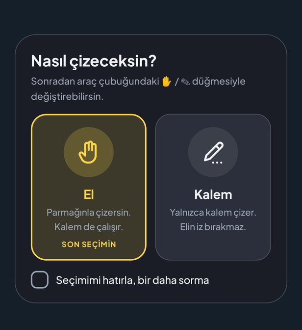
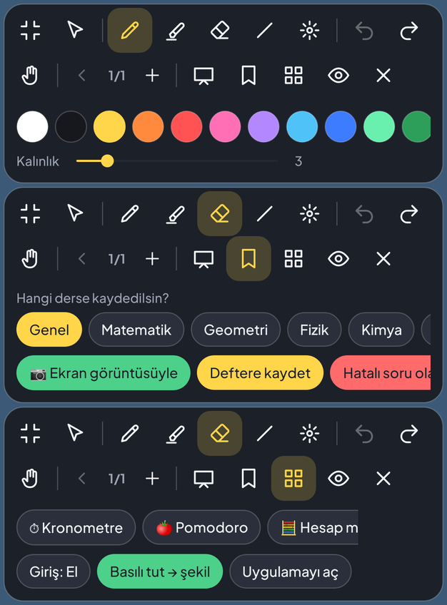
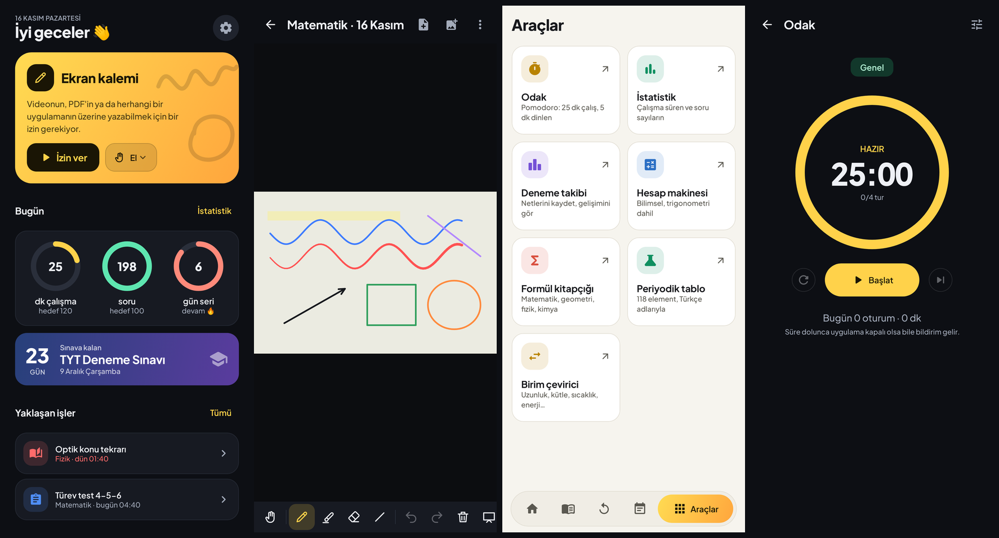
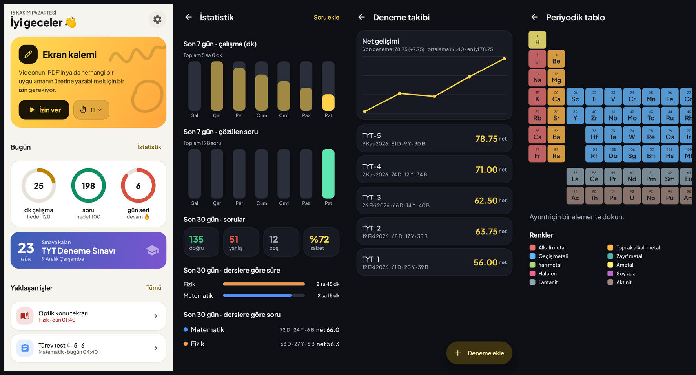
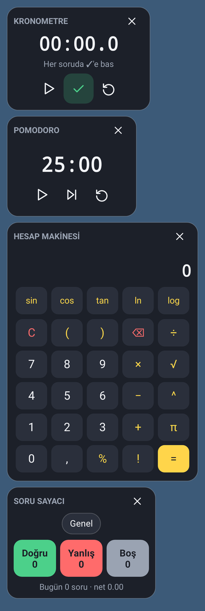

# Karala — ekran kalemi ve çalışma asistanı

Ders videosu izlerken ekrana soru gelir; durdurur, **videonun üzerine** çözersin. Karala bunu yapan bir Android
uygulamasıdır: her uygulamanın üstünde duran bir çizim katmanı ve yüzen bir araç çubuğu. Farkı, çözdüğün şeyin
kaybolmaması: tek dokunuşla **sorunun ekran görüntüsüyle birlikte** defterine ya da *hatalı soru defterine* girer ve
unutmadan önce sana yeniden sorulur.

Reklam yok, hesap yok, abonelik yok. Her şey cihazda saklanır.

**Kurulum:** [`dist/karala-1.1.0.apk`](dist/karala-1.1.0.apk) dosyasını tablete/telefona indirip aç (Android 8.0+).
İlk açılışta "diğer uygulamaların üzerinde göster" iznini ver.

> **Anahtar gri ve "Kısıtlı ayar tarafından kontrol ediliyor" mu yazıyor?** Mağaza dışından kurulan uygulamalarda
> Android bunu bir kez sorar: Ayarlar → Uygulamalar → Karala → sağ üstteki **⋮** → **Kısıtlı ayarlara izin ver**.
> Sonra izin anahtarı açılabilir. Uygulamadaki "İzin ver" düğmesi bu adımları gösteren bir rehber açar.

## El mi, kalem mi?

Ekran kalemi her başladığında nasıl çizeceğini sorar:

| Seçim | Davranış |
|---|---|
| **El** | Parmağınla çizersin; kalem ucu da çalışır. |
| **Kalem** | Yalnızca kalem ucu çizer. Elin ya da avuç içi ekrana değse de iz bırakmaz. |

"Seçimimi hatırla" ile bir daha sorulmaz; araç çubuğundaki el / kalem düğmesiyle istediğin an değiştirirsin
(uzun basınca seçim penceresi yeniden açılır). Kalem modundayken parmakla çizmeye çalışırsan kısa bir hatırlatma
görünür. Aynı seçim defter düzenleyicide ve Ayarlar'da da var.








## Ekran kalemi (katman)

| Özellik | Ayrıntı |
|---|---|
| Kalem, fosforlu, silgi | Renk paleti, kalınlık; silgi *çizgiyi sil* ya da *parça sil* modunda |
| Şekiller | Doğru, ok, dikdörtgen, elips |
| Basılı tut → şekil | Çizgiyi bitirmeden kalemi sabit tut: el çizimi doğruya / dikdörtgene / elipse düzelir |
| Lazer işaretçi | İz bırakır, bir saniyede söner |
| Dokunma modu | Çizimler ekranda kalır, dokunuşlar alttaki uygulamaya geçer (videoyu oynat/durdur) |
| Sayfalar | Her soru için ayrı sayfa; sayfalar oturumlar arasında saklanır |
| Tahta | Beyaz tahta, kara tahta, kareli, çizgili, noktalı zemin; opaklık ayarı |
| Kaydet | Seçtiğin dersin o günkü defterine ya da hatalı sorulara; istersen ekran görüntüsüyle |
| Kalem ucu desteği | Basınca duyarlı çizgi, kalemdeki silgi/düğme ile silme, el / kalem girişi (avuç içi reddi) |
| Yüzen araçlar | Kronometre (soru başı süre), Pomodoro, bilimsel hesap makinesi, doğru/yanlış/boş soru sayacı |
| Hızlı erişim | Baloncuğa küçültme, bildirimden gizle/göster, hızlı ayarlar kutucuğu, uygulama kısayolu |



## Uygulama

- **Bugün** — günlük çalışma süresi, çözülen soru, seri (üst üste gün), hedef çubukları, sınava kalan gün,
  tekrar bekleyenler, yaklaşan işler, bugünkü dersler.
- **Defterler** — derse göre defterler; sayfa ekle, galeriden soru fotoğrafı ekle, üzerine çöz,
  PNG / PDF olarak paylaş.
- **Tekrar**
  - *Hatalı soru defteri*: konu, hata nedeni (bilgi eksiği, dikkat, işlem…), kendine not. Sorular aralıklı
    tekrarla (1 gün → 3 gün → 8 gün…) geri gelir; önce çözümsüz görürsün, sonra çözümüne bakıp kendini puanlarsın.
  - *Bilgi kartları*: desteler, ön/arka yüz, aynı aralıklı tekrar algoritması.
- **Plan** — ödev / sınav / çalışma görevleri, hatırlatma bildirimi, haftalık ders programı.
- **Araçlar** — Pomodoro (uygulama kapalıyken de bildirir), istatistik (7 günlük grafik, derslere göre süre ve net),
  deneme takibi (net grafiği; 4 yanlış / 3 yanlış / götürmez), bilimsel hesap makinesi, formül kitapçığı
  (matematik, geometri, fizik, kimya; aranabilir), periyodik tablo (118 element), birim çevirici.

## İzinler

| İzin | Neden |
|---|---|
| Diğer uygulamaların üzerinde gösterme | Çizim katmanı ve araç çubuğu |
| Ön plan servisi | Katman açıkken sistemin uygulamayı kapatmaması |
| Ekran kaydı (her oturumda sistem sorar) | Yalnızca "ekran görüntüsüyle kaydet" açıksa; görüntü cihazdan çıkmaz |
| Bildirim, alarm | Pomodoro bitişi ve ödev/sınav hatırlatmaları |

İnternet izni yoktur.

## Bilinen sınırlar

- **Gerçek cihazda henüz denenmedi.** Geliştirme ortamında emülatör yoktu. Mantık birim testleriyle, ekranlar ve
  katman servisi Robolectric üzerinde gerçek piksellerle çizdirilerek doğrulandı (aşağıya bak); dokunma hissi,
  üretici arayüzleri (MIUI/HyperOS, One UI) ve ekran görüntüsü izni akışı cihazda denenmelidir.
- Dokunma modunda Android 12+ güvenlik kuralı gereği katman en fazla ~%80 opak olabilir; çizimler hafif soluk görünür.
- DRM korumalı videolar (Netflix vb.) ve "güvenli" pencereler ekran görüntüsünde siyah çıkar; çizim yine kaydedilir.
- Kalem modunda parmak dokunuşları yok sayılır ama alttaki uygulamaya da geçmez (Android, katman pencerelerinde
  dokunuşu parmağa/kaleme göre ayırıp alta iletmeye izin vermiyor); videoyu oynatmak için dokunma moduna geç.
- Katmanda metin kutusu aracı yok (klavye odağı katmanla çakışıyor).
- Arayüz yalnızca Türkçe.

## Geliştirme

```bash
./gradlew :app:testDebugUnitTest   # 40 test; ekran görüntüleri app/build/shots altına yazılır
./gradlew :app:assembleRelease     # app/build/outputs/apk/release/app-release.apk
```

Kotlin, Jetpack Compose (uygulama), klasik View (katman), Room. Paketler:

| Paket | İçerik |
|---|---|
| `ink` | Çizim modeli, geri al/yinele, silgi geometrisi, şekil tanıma, JSON biçimi, çizici, `InkView` |
| `overlay` | `OverlayService`, araç çubuğu, yüzen araçlar, ekran görüntüsü (`MediaProjection`) |
| `study` | Aralıklı tekrar (SM-2), ifade çözümleyici, Pomodoro, hatırlatmalar, birimler, formül/element verisi |
| `data` | Room varlıkları ve sorgular, sayfa dosyaları, dışa aktarma, ayarlar |
| `ui` | Compose ekranları |

Arayüz: kendi tasarım dili (`ui/Theme.kt`) — gömülü Plus Jakarta Sans yazı tipi (SIL OFL 1.1), kurşun kalem
sarısından turuncuya marka geçişi, koyu ve açık tema, yüzen hap biçimli alt menü.

`keystore/karala-dev.jks` yalnızca yan yükleme içindir ve parolası depodadır; mağazaya çıkarken kendi anahtarınla
değiştir.
